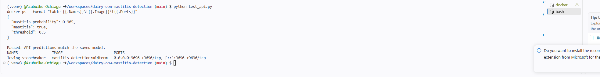
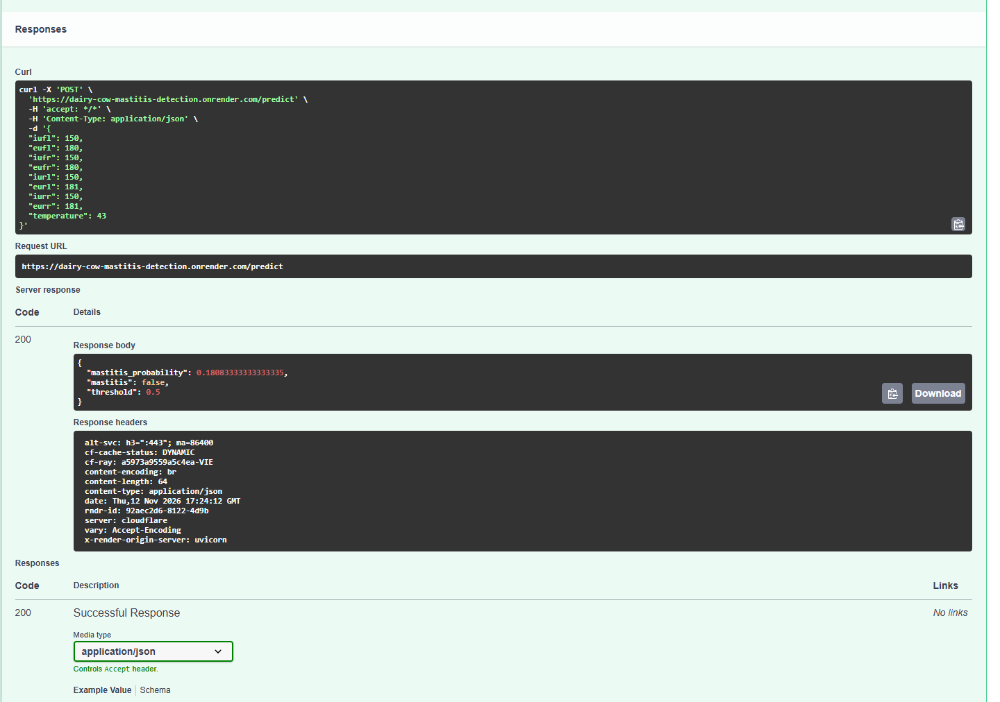

# Sensor-Based Mastitis Detection in Dairy Cows

ML Zoomcamp midterm project by Azubuike Ochiagu.

## Problem and intended use

This project investigates whether udder sensor measurements and temperature can classify a cow's recorded mastitis status.

The intended application is a prototype monitoring service that could flag records for further examination. It detects recorded status; it does not demonstrate prediction of future disease onset.

The service accepts nine numerical measurements and returns a model probability and a classification at threshold 0.5.

This is an educational prototype, not a validated veterinary diagnostic tool.

## Dataset and attribution

Source: K, Ankitha; D H, Manjaiah; M, Kartik (2020). “Data for: Clinical Mastitis in Cows based on Udder Parameter using Internet of Things (IoT)”, Mendeley Data, Version 2.

- Dataset: https://doi.org/10.17632/kbvcdw5b4m.2
- Licence: Creative Commons Attribution 4.0
- Licence terms: https://creativecommons.org/licenses/by/4.0/
- Included file: `data/clinical_mastitis_cows.csv`

The CSV was extracted unchanged from the original archive. Images from the archive are not used. Including the CSV avoids requiring reviewers to download the approximately 1.6 GB archive.

Inspection of the CSV found:

- 6,600 records and 18 columns.
- 1,100 distinct cow IDs, each with six records.
- 3,961 normal records and 2,639 mastitis records.
- No missing values or exact duplicate rows.
- No repeated cow/day combinations.

These counts describe the downloaded file. Published descriptions of the dataset differ in their reported animal and repeat counts.

Column names are standardised in memory. The original CSV is preserved.

## Repository contents

| File | Purpose |
|---|---|
| `data/clinical_mastitis_cows.csv` | Original extracted dataset |
| `notebook.ipynb` | Data preparation, EDA, model comparison, tuning, and evaluation |
| `train.py` | Train and save the selected model |
| `predict.py` | Serve predictions using FastAPI |
| `test_api.py` | Check service health and prediction consistency |
| `requirements.txt` | Pinned Python dependencies |
| `Dockerfile` | Build the prediction service container |
| `.dockerignore` | Exclude unnecessary files from the Docker build context |
| `model.bin` | Saved model, feature order, and classification threshold |
| `model_metadata.json` | Training metadata and checksums |
| `deployment-test.png` | Local Docker deployment evidence |
| `cloud-deployment.png` | Successful prediction through the public cloud API |

## Model inputs

| Input | Dataset description |
|---|---|
| `iufl`, `eufl` | Front-left udder inhale/exhale sensor limits |
| `iufr`, `eufr` | Front-right udder inhale/exhale sensor limits |
| `iurl`, `eurl` | Rear-left udder inhale/exhale sensor limits |
| `iurr`, `eurr` | Rear-right udder inhale/exhale sensor limits |
| `temperature` | Recorded temperature value |

Inputs must use the original dataset's measurement scale. Sensor units and the interpretation of temperature require clarification. Temperature values range from 24 to 58 and are retained as recorded.

Cow ID, day, breed, months after giving birth, previous mastitis status, hardness, pain, and milk visibility are excluded from the deployed model. The target column is also excluded from the inputs.

The notebook renames the target column `class1` to `mastitis`, with 0 representing normal and 1 representing mastitis.

## Exploration and model selection

`notebook.ipynb` contains:

- Data quality checks and numerical summaries.
- Target distribution and sensor distributions by class.
- Correlation analysis.
- Comparison of a dummy baseline, logistic regression, random forest, and XGBoost.
- Random forest parameter tuning using three-fold GroupKFold.
- Validation permutation importance and threshold comparison.
- Final held-out test evaluation.

### Data splitting

Cows are separated between training, validation, and test sets:

| Split | Records | Cow IDs |
|---|---:|---:|
| Training | 3,960 | 660 |
| Validation | 1,320 | 220 |
| Test | 1,320 | 220 |

GroupShuffleSplit uses `random_state=42`. Cow IDs do not overlap between splits. Cross-validation also keeps cows separate.

This prevents records from the same cow appearing in both training and evaluation sets.

### EDA findings

Sensor distributions differ between the recorded classes, but there is also overlap. Several sensor pairs are strongly correlated, which means individual features may share information.

Validation permutation importance identified `iufl`, `eurl`, and `eufr` as the three features with the largest mean decreases in ROC AUC when shuffled individually. Correlation between inputs can reduce the apparent importance of individual features.

These associations do not establish causation.

### Baseline comparison

The initial models produced the following validation results at threshold 0.5:

| Model | ROC AUC | Average precision | Accuracy | Precision | Recall | F1 |
|---|---:|---:|---:|---:|---:|---:|
| Random forest | 0.9764 | 0.9691 | 0.9182 | 0.9439 | 0.8353 | 0.8863 |
| XGBoost | 0.9696 | 0.9614 | 0.9129 | 0.9576 | 0.8075 | 0.8762 |
| Logistic regression | 0.9036 | 0.9049 | 0.8780 | 0.9858 | 0.6905 | 0.8121 |
| Dummy baseline | 0.5000 | 0.3818 | 0.6182 | 0.0000 | 0.0000 | 0.0000 |

The random forest was selected for further tuning based on its validation ROC AUC.

### Parameter tuning

The random forest search tested:

- `max_depth`: `[5, 10, None]`
- `min_samples_leaf`: `[1, 5, 10]`

The search used three-fold GroupKFold within the training set, with ROC AUC as the scoring metric.

The selected random forest uses:

- `n_estimators=200`
- `max_depth=None`
- `min_samples_leaf=1`
- `random_state=42`

Its mean cross-validation ROC AUC was approximately 0.9955, and its validation ROC AUC was approximately 0.9851.

### Threshold selection

Thresholds `[0.2, 0.3, 0.4, 0.5, 0.6]` were compared using the validation set.

Threshold 0.5 gave the highest validation F1 among the tested thresholds:

- Precision: 0.9562
- Recall: 0.9524
- F1: 0.9543
- False alerts: 22
- Missed mastitis records: 24

After model and threshold selection, the model was refitted on the combined training and validation sets: 5,280 records from 880 cows.

## Final test results

The test set was reserved until model and threshold choices were fixed.

| Metric | Score |
|---|---:|
| ROC AUC | 0.9985 |
| Average precision | 0.9978 |
| Accuracy | 0.9848 |
| Precision | 0.9772 |
| Recall | 0.9876 |
| F1 | 0.9824 |
| Specificity | 0.9828 |

Confusion matrix:

| Actual / Predicted | Normal | Mastitis |
|---|---:|---:|
| Normal | 743 | 13 |
| Mastitis | 7 | 557 |

The test set contains 1,320 records from 220 held-out cow IDs.

Metrics are calculated per record, not per unique cow. Repeated records within a cow are not independent observations.

## Limitations

- Evaluation covers held-out cow IDs from the same dataset.
- Generalisation to other farms, breeds, sensors, or collection conditions has not been established.
- Measurement units, temperature interpretation, and label-assignment procedures need further clarification.
- Model probabilities have not been calibrated as clinical risk estimates.
- Correlated sensor inputs complicate individual feature-importance interpretation.
- The threshold was selected using validation F1. Operational use would require agreed costs for missed cases and false alerts.
- High performance on this dataset does not establish suitability for veterinary diagnosis or farm deployment.

## Environment setup

The project was developed using Python 3.14.2.

Clone the repository and enter its directory:

```bash
git clone https://github.com/Azubuike-Ochiagu/dairy-cow-mastitis-detection.git
cd dairy-cow-mastitis-detection
```

Create a virtual environment:

```bash
python -m venv .venv
```

Activate it on Linux, macOS, or GitHub Codespaces:

```bash
source .venv/bin/activate
```

On Windows PowerShell, activate it with:

```powershell
.venv\Scripts\Activate.ps1
```

Install the dependencies:

```bash
python -m pip install -r requirements.txt
```

Run the following commands from the repository root.

## Run the notebook

```bash
jupyter notebook notebook.ipynb
```

Select the project virtual environment as the notebook kernel.

The notebook loads the included `data/clinical_mastitis_cows.csv` directly. No dataset download or changes to notebook cells are required.

Run all cells in order to reproduce the analysis. The notebook was checked by restarting the kernel and running all cells.

## Train the selected model

```bash
python train.py
```

This recreates the development/test split, trains on development cows only, and writes:

- `model.bin`: model, feature order, and threshold.
- `model_metadata.json`: parameters, record counts, library version, and dataset/model checksums.

The training script uses 5,280 records from 880 development cow IDs. It excludes the 220 held-out test cow IDs.

The saved model is included in the repository, so retraining is optional when testing the existing service. To rebuild the Docker image with a newly trained model, run training before building the image.

Only load pickle artifacts from trusted sources.

## Run the API locally

```bash
python -m uvicorn predict:app --host 0.0.0.0 --port 9696
```

Endpoints:

- GET `/health`: service status and model checksum.
- POST `/predict`: probability and classification.
- GET `/docs`: interactive API documentation.

Open http://localhost:9696/docs to test the service interactively.

Example request using the original dataset's numerical scale:

```bash
curl -s http://localhost:9696/predict \
  -H "Content-Type: application/json" \
  -d '{
    "iufl": 150,
    "eufl": 180,
    "iufr": 150,
    "eufr": 180,
    "iurl": 150,
    "eurl": 181,
    "iurr": 150,
    "eurr": 181,
    "temperature": 43
  }'
```

Example response from the included model:

```json
{
  "mastitis_probability": 0.18083333333333335,
  "mastitis": false,
  "threshold": 0.5
}
```

The probability is the model's output for the recorded mastitis class. It is not a calibrated clinical risk estimate.

## Run with Docker

Docker must be installed and running.

Build the image:

```bash
docker build -t mastitis-detection:midterm .
```

Stop any existing service using port 9696, then run:

```bash
docker run --rm -p 9696:9696 mastitis-detection:midterm
```

Open http://localhost:9696/docs to interact with the containerised service.

The Docker image includes the saved model and starts the FastAPI service. It does not train the model during startup.

## Verify local deployment

With the local API or Docker container running, execute in another terminal with the project environment activated:

```bash
python test_api.py
```

The client checks:

- Service health and model checksum.
- Probability range and boolean classification.
- Agreement between API predictions and the saved model.
- Correct application of the saved threshold.

The client checks the local service at port 9696. It checks deployment consistency, not predictive accuracy.

Local API and Docker prediction checks passed during development. Predictive performance is reported separately in the held-out test results.

## Local deployment evidence

The screenshot below shows the prediction checks passing and the Docker container serving the API on port 9696.



## Cloud deployment on Render

The API is deployed as a Docker web service on Render.

- Interactive API: https://dairy-cow-mastitis-detection.onrender.com/docs
- Health endpoint: https://dairy-cow-mastitis-detection.onrender.com/health
- Prediction endpoint: https://dairy-cow-mastitis-detection.onrender.com/predict

### Deployment steps

1. Create a Render Web Service from this GitHub repository.
2. Select Docker as the runtime and `main` as the branch.
3. Leave the root directory blank.
4. Set the Dockerfile path to `./Dockerfile`.
5. Select the Free instance.
6. Add the environment variable `PORT=9696`.
7. Set the health check path to `/health`.
8. Leave Docker Command empty so the service uses the Dockerfile's default startup command.
9. Deploy the service.

### Test the public service

Open the interactive API link above:

1. Expand POST `/predict`.
2. Select **Try it out**.
3. Enter the example measurements shown in this README.
4. Select **Execute**.

Alternatively, send a request from a terminal:

```bash
curl -s https://dairy-cow-mastitis-detection.onrender.com/predict \
  -H "Content-Type: application/json" \
  -d '{
    "iufl": 150,
    "eufl": 180,
    "iufr": 150,
    "eufr": 180,
    "iurl": 150,
    "eurl": 181,
    "iurr": 150,
    "eurr": 181,
    "temperature": 43
  }'
```

A public prediction request returned HTTP 200 with the example response shown above.

The Free instance sleeps after inactivity, so the first request may take about a minute.

The root URL `/` has no homepage. Use `/docs`, `/health`, or POST `/predict`.

### Cloud deployment evidence

The screenshot below shows the public request URL, submitted measurements, HTTP 200 status, and prediction response.

